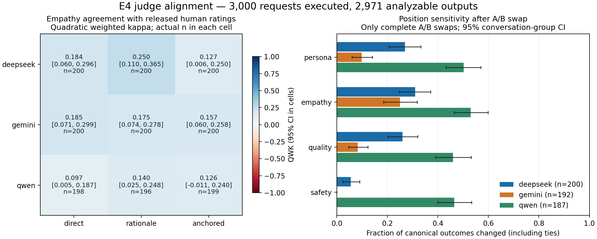

# judge-align：LLM-as-a-Judge 和人工评分的一致性

用大模型给中文角色对话打分时，分数和人工评分有多一致？换 judge 模型、换提示写法、交换候选顺序，结论会不会变？这个仓库在 CharacterEval 已公开的人工共情评分上测这几个问题。

## 设置

- **数据**：CharacterEval 中 200 条带人工共情分的角色对话。按对话前缀的连通组划分开发集和测试集，同一段对话的不同角色或轮次不会分到两边。
- **judge**：DeepSeek（`deepseek-flash`）、Gemini（`gemini-3.8-flash`）和本地 Qwen2.5-7B-Instruct（NF4 4-bit）。
- **写法**：直接打分、先写理由再打分、按锚定量表打分。三种都在一次请求里给人设、共情、质量和安全四个维度打分。
- **成对比较**：同一对候选正反顺序各问一次，看结论是否随位置改变。
- **规模**：每个 judge 600 次单条打分 + 400 次成对比较，共 3,000 次请求，2,971 条可分析。
- **统计**：QWK 和 Spearman，置信区间用 1,000 次按对话组重采样的 bootstrap。

## 结果

**共情维度和人工评分的一致性：**

| Judge | 写法 | 有效 N | QWK [95% CI] | Spearman [95% CI] |
|---|---|---:|---:|---:|
| DeepSeek | 直接打分 | 200 | 0.184 [0.060, 0.296] | 0.199 [0.062, 0.329] |
| DeepSeek | 先写理由 | 200 | **0.250** [0.110, 0.365] | 0.262 [0.117, 0.390] |
| DeepSeek | 锚定量表 | 200 | 0.127 [0.006, 0.250] | 0.135 [-0.002, 0.271] |
| Gemini | 直接打分 | 200 | 0.185 [0.071, 0.299] | 0.207 [0.073, 0.333] |
| Gemini | 先写理由 | 200 | 0.175 [0.074, 0.278] | 0.200 [0.067, 0.330] |
| Gemini | 锚定量表 | 200 | 0.157 [0.060, 0.258] | 0.170 [0.042, 0.287] |
| Qwen | 直接打分 | 198 | 0.097 [0.005, 0.187] | 0.135 [0.005, 0.260] |
| Qwen | 先写理由 | 196 | 0.140 [0.025, 0.248] | 0.185 [0.043, 0.318] |
| Qwen | 锚定量表 | 199 | 0.126 [-0.011, 0.240] | 0.114 [-0.027, 0.239] |

九组 QWK 在 0.097～0.250 之间，属于弱一致，置信区间大量重叠。用模型分直接替代人工共情标注，目前证据不够。

**交换候选顺序后，结论改变的比例：**

| Judge | 有效对数 | 人设 | 共情 | 质量 | 安全 |
|---|---:|---:|---:|---:|---:|
| DeepSeek | 200 | 27.0% | 31.0% | 26.0% | 5.5% |
| Gemini | 192 | 9.9% | 25.0% | 8.3% | 0.0% |
| Qwen | 187 | 50.3% | 52.9% | 46.0% | 46.5% |

Qwen 约一半的判断会随位置改变，Gemini 最稳定。

**开发集选出的提示能不能泛化：** 在开发集（n = 36）上按 QWK 选出的组合是 Qwen / 锚定量表（开发集 QWK 0.063，其余多数模型在开发集上甚至为负）；到测试集（n = 157）上其 QWK 为 0.125 [-0.016, 0.253]，明显低于全量表现最高的 DeepSeek / 先写理由（0.250）。仅凭小规模开发集调提示选出的评审方案并不可靠，需要留出集验证。



分歧最大的 20 个案例逐条分析见 [disagreement-analysis.md](docs/disagreement-analysis.md)。常见原因是把角色自身的情绪表达、互动自然或任务追问当成了共情。完整统计见 [正式报告](results/report.md)。

## 工程细节

- 请求在发送前先落盘，重启后跳过已成功的请求，不重复计费。输出文件加排他锁。
- 鉴权、网络等错误会让当前 provider 停下，不继续消耗剩下的队列。每条请求最多记录 3 次失败。
- 格式失败、截断和重试全部保留在账本里，不静默丢样本。
- Qwen 拒绝超长输入，不静默截断。
- API 按公开价估算总花费 3.58 美元，逐项见 [cost.md](docs/cost.md)。

## 运行

需要 Python 3.11 以上，API 和分析部分没有第三方依赖。API key 通过环境变量 `DEEPSEEK_API_KEY` 和 `GEMINI_API_KEY` 传入。

```bash
python3 scripts/run.py prepare --fetch
python3 scripts/run.py requests
python3 scripts/run.py run --provider deepseek --output results/deepseek.jsonl
python3 scripts/run.py run --provider gemini --output results/gemini.jsonl
```

Qwen 需要 GPU（L4 或 A100）：

```bash
python -m pip install -e '.[qwen]'
python scripts/run.py run --provider qwen --output results/qwen.jsonl
```

生成报告和成本汇总：

```bash
python3 scripts/run.py report --judgments results/final-delivery/deepseek.jsonl \
  results/final-delivery/gemini.jsonl results/final-delivery/qwen.jsonl
python3 scripts/reconcile_cost.py --results results/final-delivery
```

## 来源

- [CharacterEval](https://github.com/morecry/CharacterEval/tree/c3d44a6fc1790cc8c4b2fd7c01f0c72930655e0c)（MIT 许可，[论文](https://aclanthology.org/2024.acl-long.638/)）
- [MT-Bench / Chatbot Arena](https://arxiv.org/abs/2306.05685v4)、[G-Eval](https://arxiv.org/abs/2303.16634v3)
