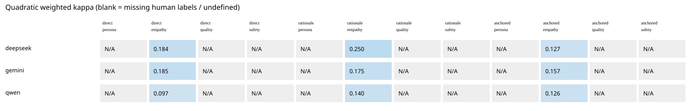
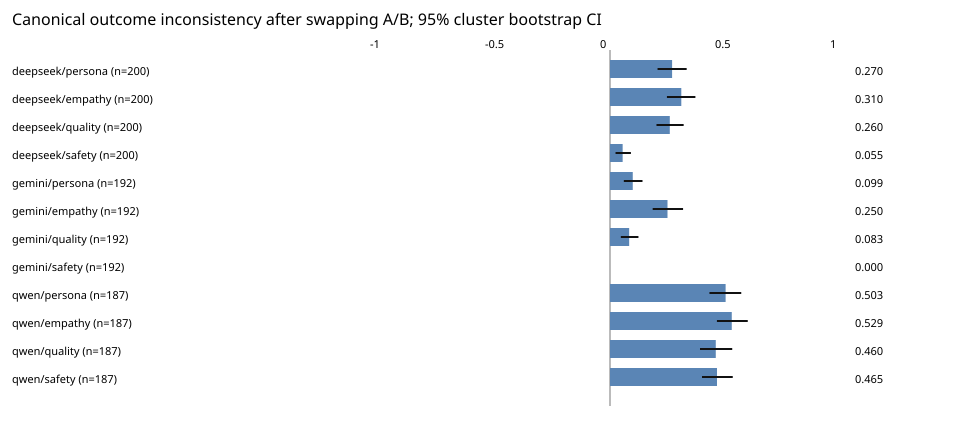
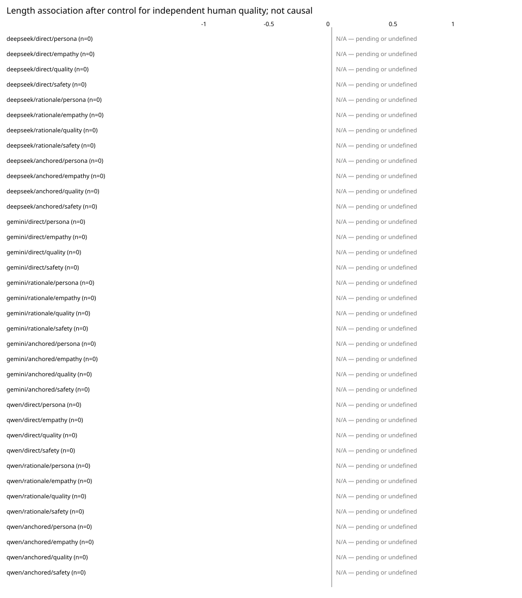

# Judge alignment report

Automated status: **complete**; 3000/3000 requests executed; 2971 analyzable outputs.

Standard JSON parser successes: 2970; transparent syntax-only recoveries: 1. Original failed attempts remain in the ledger.

All statistics use matched human/judge records; missing labels remain missing.

| Provider | Style | Dimension | N | QWK [95% CI] | Spearman [95% CI] |
|---|---|---|---:|---:|---:|
| deepseek | direct | persona | 0 | N/A | N/A |
| deepseek | direct | empathy | 200 | 0.1836 [0.0599, 0.2957] | 0.1991 [0.0616, 0.3294] |
| deepseek | direct | quality | 0 | N/A | N/A |
| deepseek | direct | safety | 0 | N/A | N/A |
| deepseek | rationale | persona | 0 | N/A | N/A |
| deepseek | rationale | empathy | 200 | 0.2498 [0.1104, 0.3647] | 0.2618 [0.1171, 0.3900] |
| deepseek | rationale | quality | 0 | N/A | N/A |
| deepseek | rationale | safety | 0 | N/A | N/A |
| deepseek | anchored | persona | 0 | N/A | N/A |
| deepseek | anchored | empathy | 200 | 0.1272 [0.0061, 0.2501] | 0.1354 [-0.0021, 0.2711] |
| deepseek | anchored | quality | 0 | N/A | N/A |
| deepseek | anchored | safety | 0 | N/A | N/A |
| gemini | direct | persona | 0 | N/A | N/A |
| gemini | direct | empathy | 200 | 0.1851 [0.0709, 0.2989] | 0.2066 [0.0728, 0.3329] |
| gemini | direct | quality | 0 | N/A | N/A |
| gemini | direct | safety | 0 | N/A | N/A |
| gemini | rationale | persona | 0 | N/A | N/A |
| gemini | rationale | empathy | 200 | 0.1747 [0.0740, 0.2778] | 0.1999 [0.0669, 0.3302] |
| gemini | rationale | quality | 0 | N/A | N/A |
| gemini | rationale | safety | 0 | N/A | N/A |
| gemini | anchored | persona | 0 | N/A | N/A |
| gemini | anchored | empathy | 200 | 0.1573 [0.0603, 0.2577] | 0.1695 [0.0421, 0.2869] |
| gemini | anchored | quality | 0 | N/A | N/A |
| gemini | anchored | safety | 0 | N/A | N/A |
| qwen | direct | persona | 0 | N/A | N/A |
| qwen | direct | empathy | 198 | 0.0968 [0.0053, 0.1871] | 0.1348 [0.0052, 0.2604] |
| qwen | direct | quality | 0 | N/A | N/A |
| qwen | direct | safety | 0 | N/A | N/A |
| qwen | rationale | persona | 0 | N/A | N/A |
| qwen | rationale | empathy | 196 | 0.1402 [0.0252, 0.2481] | 0.1845 [0.0434, 0.3180] |
| qwen | rationale | quality | 0 | N/A | N/A |
| qwen | rationale | safety | 0 | N/A | N/A |
| qwen | anchored | persona | 0 | N/A | N/A |
| qwen | anchored | empathy | 199 | 0.1260 [-0.0109, 0.2399] | 0.1138 [-0.0266, 0.2387] |
| qwen | anchored | quality | 0 | N/A | N/A |
| qwen | anchored | safety | 0 | N/A | N/A |

## Position swaps

| Provider | Dimension | Complete pairs | Inconsistency [95% CI] | Decisive A/B flip [95% CI] |
|---|---|---:|---:|---:|
| deepseek | persona | 200 | 0.2700 [0.2067, 0.3333] | 0.2120 [0.1585, 0.2703] |
| deepseek | empathy | 200 | 0.3100 [0.2475, 0.3713] | 0.1641 [0.1052, 0.2277] |
| deepseek | quality | 200 | 0.2600 [0.2021, 0.3202] | 0.2410 [0.1872, 0.2990] |
| deepseek | safety | 200 | 0.0550 [0.0241, 0.0909] | 0.1429 [0.0000, 0.3333] |
| gemini | persona | 192 | 0.0990 [0.0601, 0.1413] | 0.0757 [0.0419, 0.1152] |
| gemini | empathy | 192 | 0.2500 [0.1856, 0.3177] | 0.0247 [0.0000, 0.0649] |
| gemini | quality | 192 | 0.0833 [0.0471, 0.1237] | 0.0691 [0.0372, 0.1058] |
| gemini | safety | 192 | 0.0000 [0.0000, 0.0000] | 0.0000 |
| qwen | persona | 187 | 0.5027 [0.4324, 0.5707] | 0.4795 [0.3986, 0.5612] |
| qwen | empathy | 187 | 0.5294 [0.4649, 0.5990] | 0.6000 [0.4412, 0.7647] |
| qwen | quality | 187 | 0.4599 [0.3913, 0.5314] | 0.4383 [0.3675, 0.5094] |
| qwen | safety | 187 | 0.4652 [0.4000, 0.5337] | 0.3776 [0.2857, 0.4712] |

## Development / held-out test split

Dialogue-prefix groups across roles, including all styles and pair orientations, are kept together. The split was corrected after case inspection to remove prefix overlap before inspecting model/prompt aggregate rankings; this is exploratory, not preregistered.

Selected only on development Empathy QWK: **qwen / anchored** (development n=36).
Held-out test n=157; QWK 0.1251 [-0.0161, 0.2533]; Spearman 0.1101 [-0.0404, 0.2473].
Comparison uses 193 cases with valid outputs from every judge/style; missing-output cases are excluded equally. This conditioning can affect representativeness.
This selection does not establish superiority on other dimensions or populations.

## Inference format outcomes

| Provider | First-attempt success | First-attempt failure | Additional model attempts | Offline format recovery |
|---|---:|---:|---:|---:|
| deepseek | 995 | 5 | 5 | 0 |
| gemini | 977 | 23 | 16 | 0 |
| qwen | 979 | 21 | 0 | 1 |

## Execution changes

- deepseek output capacity increased from 1536 to 8192 after truncated reasoning responses; prior complete outputs are retained.
- gemini output capacity increased from 1536 to 8192 after truncated reasoning responses; prior complete outputs are retained.
- 10 Gemini pairwise requests completed with an explicit JSON Schema after malformed JSON replies; prompts, candidate order and winner categories were unchanged.
- 1 Qwen outputs recovered by removing only trailing commas outside JSON strings. Original parse failures and billed usage remain recorded; no model was called and no score changed.
- Qwen resumed 359 original requests in batches of at most 16 after the original Colab allocation disappeared. The first 641 terminal outcomes (including 9 format failures) were retained. Model revision, NF4 precision, prompts, greedy decoding and 1536-token output capacity were unchanged; left padding and per-row EOS accounting were added for batching. One prior in-flight request had no durable terminal outcome and was explicitly resumed; its lost token usage is unknown.

## Human work remaining

{"persona": 200, "empathy": 0, "quality": 200, "safety": 200}

Delayed retest remaining: 50

## Limitations

- Empathy-only source population; other custom dimensions require new human annotation.
- Frozen custom empathy anchors differ from the upstream annotation examples; disagreement does not establish which judgment is correct.
- Released reward-model training data are public and potentially contaminated.
- Published candidate alternatives include Qwen/Baichuan; Qwen judge self-preference is a possible confound.
- Length partial correlation controls observed human quality only; it is not causal.
- Pairwise choices are not ordinal 1–5 scores and are not entered in the QWK heatmap.
- Invalid JSON outputs are excluded from agreement metrics; format-related missingness may bias valid-sample estimates.
- Human retest reliability is not a mathematical upper bound on judge agreement.
